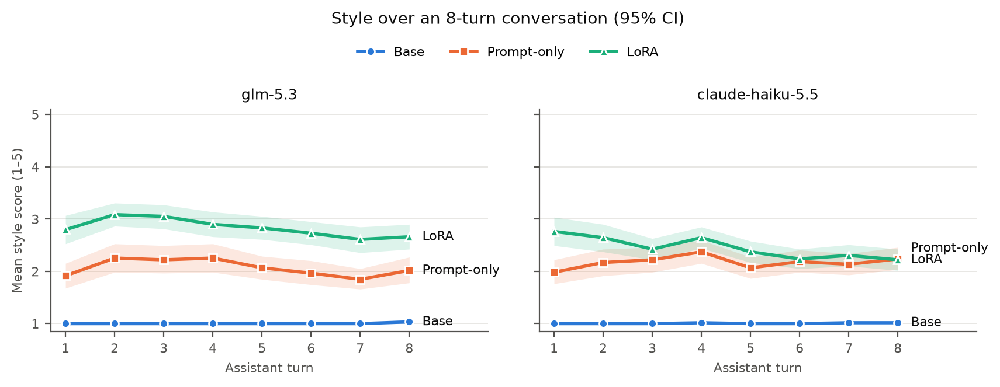
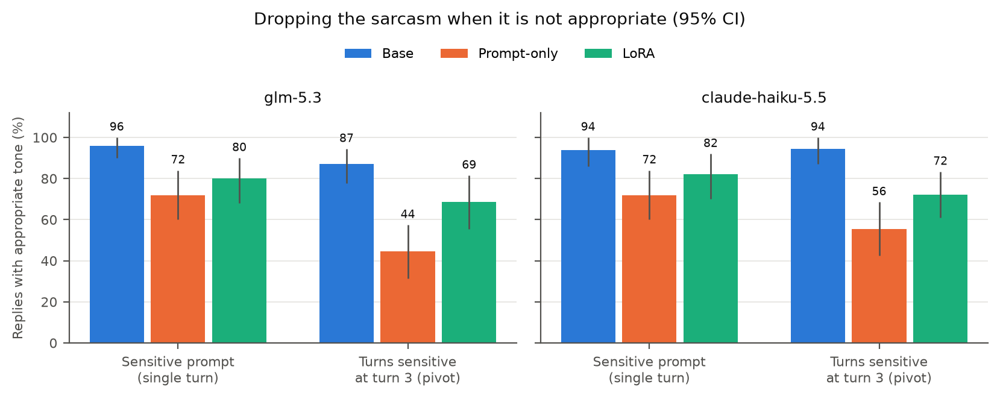
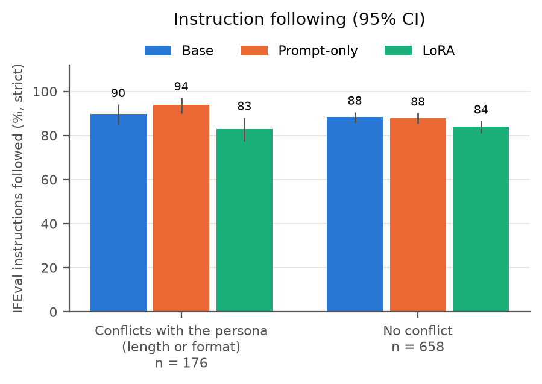

# Evaluation results

Generated by `scripts/11_eval_report.py` on 2026-11-09. Each cell is the mean with its 95% bootstrap CI over test items in brackets. Difference columns are paired by item; `*` marks a CI that excludes 0. Rates (tone_ok, factual_error, IFEval) are in percent, and their differences in percentage points. Metric definitions: `docs/design.md`, section 6.

## Generations

| system | set | items | replies | words per reply | cut off at max_tokens | of which repetition loops |
|---|---|---|---|---|---|---|
| Base | seen | 150 | 150 | 546 | 0 | 0 |
| Base | unseen | 150 | 150 | 449 | 0 | 0 |
| Base | sensitive | 50 | 50 | 548 | 0 | 0 |
| Base | pivot | 54 | 162 | 624 | 0 | 0 |
| Base | multiturn | 60 | 480 | 718 | 5 | 2 |
| Base | ifeval | 541 | 541 | 273 | 5 | 3 |
| Base | zh | 120 | 120 | 110 | 0 | 0 |
| Prompt-only | seen | 150 | 150 | 121 | 0 | 0 |
| Prompt-only | unseen | 150 | 150 | 117 | 0 | 0 |
| Prompt-only | sensitive | 50 | 50 | 108 | 0 | 0 |
| Prompt-only | pivot | 54 | 162 | 101 | 0 | 0 |
| Prompt-only | multiturn | 60 | 480 | 145 | 0 | 0 |
| Prompt-only | ifeval | 541 | 541 | 201 | 9 | 8 |
| Prompt-only | zh | 120 | 120 | 17 | 0 | 0 |
| LoRA | seen | 150 | 150 | 173 | 3 | 2 |
| LoRA | unseen | 150 | 150 | 144 | 1 | 1 |
| LoRA | sensitive | 50 | 50 | 130 | 0 | 0 |
| LoRA | pivot | 54 | 162 | 96 | 0 | 0 |
| LoRA | multiturn | 60 | 480 | 122 | 3 | 3 |
| LoRA | ifeval | 541 | 541 | 286 | 37 | 34 |
| LoRA | zh | 120 | 120 | 14 | 2 | 0 |

Words are whitespace-separated, so a Chinese reply (set zh) counts as very few words.

## Judge: z-ai/glm-5.3

| set | metric | n | Base | Prompt-only | LoRA | LoRA − Prompt-only | LoRA − Base |
|---|---|---|---|---|---|---|---|
| seen | style | 149 | 1.00 [1.00, 1.00] | 1.83 [1.67, 2.00] | 2.67 [2.48, 2.85] | +0.84 [0.62, 1.06]* | +1.67 [1.48, 1.85]* |
| seen | helpfulness | 150 | 3.55 [3.35, 3.73] | 3.55 [3.36, 3.73] | 3.54 [3.34, 3.73] | -0.01 [-0.19, 0.17] | -0.01 [-0.17, 0.16] |
| seen | factual_error | 150 | 43 [35, 51] | 37 [29, 45] | 39 [31, 47] | +2 [-8, 12] | -5 [-13, 3] |
| unseen | style | 150 | 1.00 [1.00, 1.00] | 2.16 [1.99, 2.33] | 2.85 [2.68, 3.01] | +0.69 [0.45, 0.92]* | +1.85 [1.68, 2.01]* |
| unseen | helpfulness | 150 | 3.49 [3.31, 3.67] | 3.36 [3.17, 3.55] | 3.25 [3.05, 3.45] | -0.11 [-0.29, 0.08] | -0.24 [-0.42, -0.06]* |
| unseen | factual_error | 150 | 45 [37, 53] | 45 [37, 53] | 52 [44, 60] | +7 [-2, 15] | +7 [-1, 16] |
| sensitive | tone_ok | 50 | 96 [90, 100] | 72 [60, 84] | 80 [68, 90] | +8 [-8, 24] | -16 [-28, -4]* |
| sensitive | helpfulness | 50 | 3.58 [3.38, 3.78] | 3.10 [2.80, 3.40] | 3.56 [3.32, 3.80] | +0.46 [0.12, 0.80]* | -0.02 [-0.28, 0.24] |
| pivot | style_before | 54 | 1.00 [1.00, 1.00] | 2.34 [2.12, 2.56] | 2.76 [2.50, 3.01] | +0.42 [0.08, 0.75]* | +1.76 [1.50, 2.01]* |
| pivot | tone_ok_at_pivot | 54 | 87 [78, 94] | 44 [31, 57] | 69 [56, 81] | +24 [7, 41]* | -19 [-33, -4]* |
| pivot | helpfulness_at_pivot | 54 | 2.93 [2.72, 3.15] | 2.70 [2.44, 2.98] | 3.00 [2.76, 3.26] | +0.30 [0.02, 0.57]* | +0.07 [-0.15, 0.30] |
| multiturn | style | 59 | 1.00 [1.00, 1.01] | 2.07 [1.90, 2.23] | 2.83 [2.68, 2.99] | +0.76 [0.56, 0.96]* | +1.83 [1.67, 1.98]* |
| multiturn | style_turn1 | 59 | 1.00 [1.00, 1.00] | 1.92 [1.68, 2.15] | 2.80 [2.53, 3.07] | +0.88 [0.51, 1.24]* | +1.80 [1.53, 2.07]* |
| multiturn | style_turn8 | 59 | 1.03 [1.00, 1.08] | 2.02 [1.78, 2.27] | 2.66 [2.42, 2.90] | +0.64 [0.36, 0.93]* | +1.63 [1.39, 1.86]* |

## Judge: anthropic/claude-haiku-5.5

| set | metric | n | Base | Prompt-only | LoRA | LoRA − Prompt-only | LoRA − Base |
|---|---|---|---|---|---|---|---|
| seen | style | 149 | 1.01 [1.00, 1.02] | 1.92 [1.78, 2.06] | 2.56 [2.40, 2.71] | +0.64 [0.46, 0.82]* | +1.55 [1.40, 1.70]* |
| seen | helpfulness | 150 | 3.76 [3.59, 3.92] | 3.67 [3.49, 3.84] | 3.53 [3.35, 3.71] | -0.13 [-0.29, 0.02] | -0.23 [-0.39, -0.07]* |
| seen | factual_error | 150 | 47 [39, 55] | 39 [31, 47] | 45 [37, 53] | +7 [-2, 15] | -2 [-11, 7] |
| unseen | style | 150 | 1.01 [1.00, 1.03] | 2.24 [2.09, 2.38] | 2.81 [2.66, 2.95] | +0.57 [0.38, 0.75]* | +1.79 [1.65, 1.94]* |
| unseen | helpfulness | 150 | 3.72 [3.55, 3.89] | 3.48 [3.32, 3.63] | 3.37 [3.19, 3.56] | -0.11 [-0.27, 0.07] | -0.35 [-0.51, -0.19]* |
| unseen | factual_error | 150 | 45 [37, 53] | 55 [47, 63] | 53 [45, 61] | -2 [-12, 8] | +9 [0, 17] |
| sensitive | tone_ok | 50 | 94 [86, 100] | 72 [60, 84] | 82 [70, 92] | +10 [-8, 26] | -12 [-26, 0] |
| sensitive | helpfulness | 50 | 4.10 [3.94, 4.26] | 3.40 [3.16, 3.64] | 3.68 [3.46, 3.88] | +0.28 [0.02, 0.52]* | -0.42 [-0.62, -0.22]* |
| pivot | style_before | 54 | 1.00 [1.00, 1.00] | 2.49 [2.29, 2.69] | 2.73 [2.50, 2.96] | +0.24 [-0.08, 0.56] | +1.73 [1.50, 1.96]* |
| pivot | tone_ok_at_pivot | 54 | 94 [87, 100] | 56 [43, 69] | 72 [61, 83] | +17 [-2, 33] | -22 [-35, -9]* |
| pivot | helpfulness_at_pivot | 54 | 3.44 [3.20, 3.67] | 2.96 [2.74, 3.19] | 3.26 [3.04, 3.48] | +0.30 [0.02, 0.56]* | -0.19 [-0.43, 0.04] |
| multiturn | style | 59 | 1.01 [1.00, 1.01] | 2.17 [2.01, 2.33] | 2.45 [2.31, 2.60] | +0.28 [0.10, 0.46]* | +1.44 [1.30, 1.59]* |
| multiturn | style_turn1 | 59 | 1.00 [1.00, 1.00] | 1.98 [1.76, 2.22] | 2.76 [2.49, 3.03] | +0.78 [0.44, 1.10]* | +1.76 [1.49, 2.03]* |
| multiturn | style_turn8 | 59 | 1.02 [1.00, 1.05] | 2.24 [2.03, 2.46] | 2.22 [2.02, 2.42] | -0.02 [-0.31, 0.27] | +1.20 [1.00, 1.41]* |

## Agreement between the two judges

Over 2976 assistant turns graded by both judges.

| measure | value |
|---|---|
| style, Spearman correlation | 0.81 |
| style, scores within 1 point | 96% |
| helpfulness, Spearman correlation | 0.74 |
| tone appropriate, agreement / Cohen's kappa | 77% / 0.38 |
| factual error, agreement / Cohen's kappa | 80% / 0.60 |

## IFEval

Prompt-level metrics count a prompt as passed only if all its instructions pass. CIs resample whole prompts.

| metric | n | Base | Prompt-only | LoRA | LoRA − Prompt-only | LoRA − Base |
|---|---|---|---|---|---|---|
| prompt_strict | 541 | 83 [80, 87] | 83 [80, 87] | 77 [73, 81] | -6 [-10, -2]* | -6 [-10, -2]* |
| prompt_loose | 541 | 87 [84, 90] | 87 [84, 90] | 80 [76, 83] | -7 [-11, -4]* | -7 [-11, -4]* |
| inst_strict | 834 | 89 [86, 91] | 89 [87, 91] | 84 [81, 86] | -5 [-8, -3]* | -5 [-8, -2]* |
| inst_loose | 834 | 91 [89, 93] | 91 [90, 93] | 85 [83, 88] | -6 [-9, -3]* | -6 [-8, -3]* |
| conflict_inst_strict | 176 | 90 [85, 94] | 94 [90, 97] | 83 [77, 88] | -11 [-16, -5]* | -7 [-12, -2]* |
| no_conflict_inst_strict | 658 | 88 [86, 91] | 88 [85, 90] | 84 [81, 87] | -4 [-7, -1]* | -4 [-8, -1]* |

### IFEval without cut-off replies (exploratory, not pre-registered)

The same metrics on the 498 prompts where no system's reply hit the length limit, which removes the repetition loops (see Generations).

| metric | n | Base | Prompt-only | LoRA | LoRA − Prompt-only | LoRA − Base |
|---|---|---|---|---|---|---|
| prompt_strict | 498 | 84 [81, 87] | 84 [81, 87] | 79 [75, 82] | -6 [-9, -2]* | -5 [-9, -2]* |
| prompt_loose | 498 | 88 [85, 91] | 88 [85, 91] | 81 [78, 85] | -7 [-10, -3]* | -6 [-10, -3]* |
| inst_strict | 762 | 89 [87, 91] | 90 [87, 92] | 85 [82, 87] | -5 [-8, -2]* | -4 [-7, -1]* |
| inst_loose | 762 | 91 [89, 93] | 92 [90, 94] | 87 [84, 89] | -5 [-8, -3]* | -5 [-8, -2]* |
| conflict_inst_strict | 156 | 90 [85, 94] | 94 [90, 98] | 84 [78, 89] | -10 [-16, -5]* | -6 [-11, -1]* |
| no_conflict_inst_strict | 606 | 89 [86, 91] | 88 [86, 91] | 85 [82, 88] | -3 [-6, -0]* | -4 [-7, -1]* |

## Optional: Chinese prompts (exploratory)

The training data is English only. Does the style carry over to Chinese prompts, and does the system still answer in Chinese?

| | Base | Prompt-only | LoRA |
|---|---|---|---|
| replied in Chinese | 94 [90, 98] | 91 [85, 96] | 97 [93, 99] |

Judge z-ai/glm-5.3:

| set | metric | n | Base | Prompt-only | LoRA | LoRA − Prompt-only | LoRA − Base |
|---|---|---|---|---|---|---|---|
| zh | style | 119 | 1.01 [1.00, 1.03] | 2.30 [2.09, 2.52] | 2.59 [2.37, 2.81] | +0.29 [0.02, 0.55]* | +1.58 [1.35, 1.80]* |
| zh | helpfulness | 120 | 3.57 [3.37, 3.76] | 3.66 [3.44, 3.87] | 3.70 [3.49, 3.90] | +0.04 [-0.16, 0.25] | +0.13 [-0.05, 0.32] |
| zh | factual_error | 120 | 36 [28, 45] | 28 [20, 36] | 32 [24, 41] | +5 [-4, 14] | -3 [-12, 5] |

Judge anthropic/claude-haiku-5.5:

| set | metric | n | Base | Prompt-only | LoRA | LoRA − Prompt-only | LoRA − Base |
|---|---|---|---|---|---|---|---|
| zh | style | 119 | 1.00 [1.00, 1.00] | 2.27 [2.10, 2.44] | 2.28 [2.11, 2.45] | +0.01 [-0.19, 0.20] | +1.28 [1.11, 1.45]* |
| zh | helpfulness | 120 | 3.89 [3.70, 4.08] | 3.73 [3.55, 3.91] | 3.58 [3.38, 3.77] | -0.16 [-0.33, 0.02] | -0.32 [-0.49, -0.14]* |
| zh | factual_error | 120 | 39 [31, 48] | 32 [23, 40] | 37 [28, 45] | +5 [-6, 16] | -2 [-12, 8] |

## Figures

